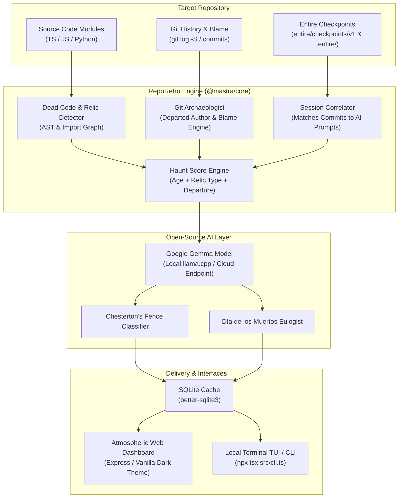

# 💀 RepoRetro (Ghost in the Repo)

> **An archaeological AI agent that finds dead code and long-gone contributors in a repo, then explains why each piece exists using commit history and agent sessions.**  
> _Built for the Hacktoberfest 2026 Open-Source AI Challenge: Week 4 ("Ghost in the Machine")_  
> **Lead Category:** Best Use of Gemma ($200) • **Hosting:** Best Use of Render ($200) / Best Use of DigitalOcean ($200) • **Partners:** Best Use of Entire ($100), Best Use of Mastra ($100)

[](https://dev.to/challenges/hacktoberfest-week4-2026-10-26)
[](LICENSE)
[](https://ai.google.dev/gemma)
[](https://render.com)
[](https://digitalocean.com)
[](https://entire.io)
[](https://mastra.ai)

---

## 📖 What is RepoRetro?

Every mature software repository is haunted.

Old functions sit uncalled in dark corners. Commented-out blocks linger like restless phantoms. Crucial compatibility shims look like dead code to automated linters, but removing them summons breaking bugs. And behind each piece of code are **long-gone contributors**—developers who poured their creativity into the project years ago and moved on, leaving their digital footprints behind.

In the spirit of **Halloween** and **Día de los Muertos**, **RepoRetro** bridges past and present:
1. **The Code Graveyard:** Automatically identifies unreferenced exports, orphan modules, commented relics, and zombie `TODO` markers, computing a **Haunt Score (0–100)**.
2. **Commit & Agent Archaeology:** Uses `git blame`, `git log -S` (pickaxe search), and **Entire git-native checkpoints (`entire/checkpoints/v1`)** to uncover the exact prompts, tool calls, and decisions that generated each piece of code.
3. **Chesterton’s Fence Verdicts:** Powered by **Google Gemma**, it reasons through *why* the code was written and assigns an actionable verdict:
   - 🕯️ **Load-Bearing Relic:** Keep and document (e.g. legacy banking fallback).
   - 🪦 **Safe to Lay to Rest:** Truly abandoned code ready for clean removal.
   - 🌼 **Unfinished Ghost Work:** Incomplete feature branch ready to resurrect.
4. **Día de los Muertos Ofrenda:** Generates respectful, poetic remembrance tribute cards honoring departed contributors ($>6$ months inactive) and their enduring architectural legacy.

---

## 🏛️ System Architecture



---

## 🛡️ Why Open Innovation Matters

Hacktoberfest 2026 prompt requirement: *“Tell us where your open-based approach worked better than a closed one.”*

1. **100% Air-Gapped Codebase Privacy:** Software archaeology requires scanning full git commit histories, unreleased code, and internal developer notes. By running open-weight **Google Gemma** locally via `llama-server` (`llama.cpp`), zero bytes of proprietary code ever touch third-party cloud servers.
2. **Immortal Institutional Memory:** When proprietary AI chat services shut down or change terms, cloud chat logs disappear. By using **Entire's git-native checkpoints** (stored on `entire/checkpoints/v1`) and open Markdown/JSONL logs, the reasoning behind your codebase is versioned inside Git itself forever.
3. **Nuanced Archaeology vs. Blind Linters:** Blind linters delete code that lacks call sites in `HEAD`. Open-weight Gemma acts as a thoughtful scholar: inspecting commit eras and agent prompts to protect sacred load-bearing workarounds.
4. **Honoring Human Craftsmanship:** RepoRetro transforms the cold finger-pointing of `git blame` into a community celebration of the people who built the foundation before us.

---

## 🚀 Quickstart

### Prerequisites
- Node.js v20+ or v24+
- Git
- Docker (for running the local llama-server)

### 1. Installation
```bash
git clone https://github.com/AndyKhang404/reporetro.git
cd reporetro
npm install
```

### 2. Start the AI Server (llama-server)
Start the local `llama-server` powered by Google Gemma 2 2B (automatically downloads and caches the GGUF model):
```bash
# Start llama-server interactively:
npm run llama-server

# Or start in the background:
npm run ai:start

# To stop:
npm run ai:stop
```

### 3. Run the CLI Scanner
Scan any local git repository, public repo, or **private repository with user-added credentials** (defaults to the bundled Haunted Showcase Repo):
```bash
# Scan the bundled Haunted Showcase Repo
npm run cli scan

# Scan any local project or public git repo
npm run cli scan /path/to/your/git/repo
npm run cli scan https://github.com/owner/repo

# Scan private repo with Personal Access Token (PAT)
npm run cli scan https://github.com/owner/private-repo --token ghp_yourTokenHere

# Scan private repo with username + token / password
npm run cli scan https://gitlab.com/owner/private-repo --username yourUser --password yourPass

# Scan private repo via SSH Private Key
npm run cli scan git@github.com:owner/private-repo.git --ssh-key ~/.ssh/id_ed25519
```

> **Tip:** You can also define `GITHUB_TOKEN`, `GIT_TOKEN`, `GIT_USERNAME`, `GIT_PASSWORD`, or `GIT_SSH_KEY` in your `.env` file as default credentials.

### 4. Launch the Web Dashboard
```bash
npm start
# Visit http://localhost:3000
```
On the dashboard:
- Click **"🕯️ Load Haunted Showcase Repo"** for an instant archaeological demonstration.
- Or paste any local directory path, public GitHub URL, or private Git URL.
- Expand **"🔒 Private Repository Credentials"** to add a Personal Access Token (PAT) or upload/paste an SSH private key. Credentials remain in memory during scan and are never stored on disk.

---

## 🧪 Testing

RepoRetro includes an automated test suite verifying the Git analyzer, session correlator, and dead code detector:
```bash
npm test
```

---

## ☁️ Deployment

### Deploy to Render
RepoRetro includes a native `render.yaml` Blueprint:
1. Push this repository to GitHub.
2. In Render, select **Blueprints** → Connect your repo.
3. Render automatically builds and deploys the web service with persistent SQLite disk storage.

### Deploy to DigitalOcean
Use the included `.do/app.yaml` for DigitalOcean App Platform, or launch via Docker:
```bash
docker compose up -d
```

---

## 📄 License

MIT © 2026 [AndyKhang404](https://github.com/AndyKhang404)
